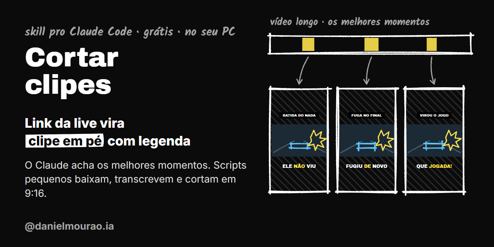
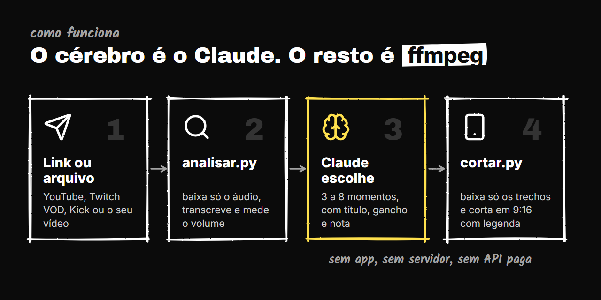
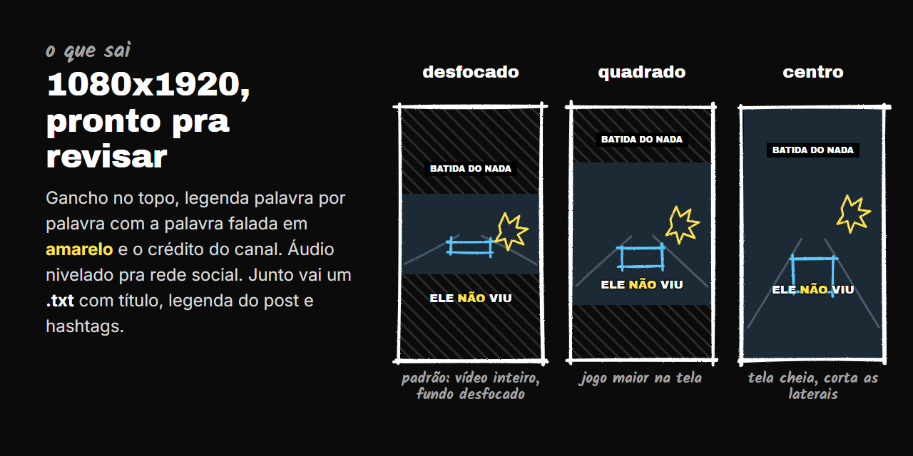

<a id="topo"></a>

<p align="center">
  
</p>

# Cortar clipes

**Uma Skill pro Claude Code (e pro Codex, de quem usa ChatGPT) que transforma uma live gravada ou um vídeo longo em clipes em pé, com legenda.**<br>
Você cola o link, o Claude acha os melhores momentos e o seu PC corta em 9:16, com legenda palavra por palavra, título, hashtags e crédito.

Claude Code ou Codex · Windows, Mac e Linux · grátis · roda no seu computador

**[↓ BAIXAR A SKILL](cortar-clipes.zip)** · **[→ O QUE PRECISA](#01--o-que-precisa)** · **[→ COMO USAR](#03--usar)** · **[↗ @DANIELMOURAO.IA](https://www.tiktok.com/@danielmourao.ia)**

---

## 00 / O que ela faz

| | O que você recebe |
|---|---|
| **Clipes** | De 3 a 8 vídeos 1080x1920, de 20 a 60 s, com o áudio nivelado pra rede social. |
| **Legenda** | Queimada no vídeo, palavra por palavra, com a palavra falada em amarelo. No idioma do vídeo. |
| **Gancho** | Uma frase curta no topo do clipe, escrita pelo Claude pra segurar quem rola o feed. |
| **Texto do post** | Um `.txt` por clipe: título, legenda do post, 3 a 5 hashtags, crédito do canal e o link do trecho original. |
| **Painel** | Uma imagem com um quadro de cada clipe lado a lado, pra revisar tudo de uma vez. |



> **Por que o Claude escolhe:** ele lê a fala inteira com o volume de cada segundo marcado. Grito, risada, "não acredito", silêncio seguido de explosão: é isso que vira clipe. Os scripts só fazem o trabalho braçal.

---

## 01 / O que precisa

| | Como conferir | Como instalar |
|---|---|---|
| **Claude Code** ou **Codex** | `claude --version` ou `codex --version` | [claude.com/claude-code](https://claude.com/claude-code) · [developers.openai.com/codex](https://developers.openai.com/codex) |
| **Python 3.10 ou mais novo** | `python --version` | [python.org](https://www.python.org/downloads/) |
| **ffmpeg** | `ffmpeg -version` | Windows `winget install Gyan.FFmpeg` · Mac `brew install ffmpeg` · Linux `sudo apt install ffmpeg` |
| **faster-whisper e yt-dlp** | `python -c "import faster_whisper, yt_dlp"` | `pip install faster-whisper yt-dlp` |

- **Computador:** 8 GB de RAM já roda. Placa de vídeo não precisa.
- **Disco:** o modelo de transcrição padrão (`small`) baixa uma vez só, uns 500 MB. Cada clipe de 30 a 50 s tem uns 20 MB.
- **Conta, chave ou cartão:** nenhum.

> Se faltar alguma coisa, a própria Skill avisa e mostra o comando. Ela **pergunta antes** de instalar.

---

## 02 / Instalar no Claude Code

Baixa o [`cortar-clipes.zip`](cortar-clipes.zip), descompacta e coloca a pasta `cortar-clipes/` (a que tem o `SKILL.md`) na pasta de Skills:

| Vale pra | Pasta |
|---|---|
| **Todos os seus projetos** | `~/.claude/skills/cortar-clipes/` |
| **Só um projeto** | `.claude/skills/cortar-clipes/` dentro do projeto |

No Windows, `~` é a sua pasta de usuário (`C:\Users\SEU-NOME`). Abre o Claude Code de novo e pronto.

> **Usa ChatGPT?** A Skill segue o mesmo formato que o **Codex** (o agente do ChatGPT pro computador) lê: coloca a pasta em `~/.codex/skills/cortar-clipes/` e abre o Codex de novo. Nós testamos no Claude Code; se algo diferir no Codex, abre uma issue.

> **E no claude.ai ou no ChatGPT do site?** Não. A Skill precisa baixar o vídeo e rodar o ffmpeg no seu computador, e isso só o Claude Code ou o Codex fazem.

---

## 03 / Usar

Abre o Claude Code numa pasta vazia (os clipes saem nela) e pede:

| Pra | Escreve |
|---|---|
| **Cortar uma live gravada** | `corta os melhores momentos dessa live: https://www.twitch.tv/videos/...` |
| **Um vídeo do YouTube** | `faz 5 clipes desse vídeo pro TikTok: https://www.youtube.com/watch?v=...` |
| **Um arquivo seu** | `corta clipes da minha gameplay: C:\Videos\partida.mp4` |
| **Só um pedaço de uma live longa** | `corta clipes dessa live, só da 1h até 1h30: <link>` |

O que acontece:

1. **Análise.** Baixa só o áudio, transcreve e mede o volume. Leva até 1/3 da duração do vídeo (tabela abaixo).
2. **Escolha.** O Claude lê tudo e mostra a lista: trecho, título, nota e motivo.
3. **Corte.** Baixa só os trechos escolhidos, até 1080p, e monta os clipes na pasta `clipes/`.
4. **Revisão.** Você assiste, pede ajuste ("começa 2 segundos antes no 3", "tira o 5", "faz o 2 com o jogo maior") e ele refaz só aquele.



Live **ao vivo** não dá: espera acabar e usa o link da gravação.

---

## 04 / Quanto tempo leva

Medido num notebook comum (Intel Core 5 de 12 núcleos lógicos, 16 GB de RAM, **sem placa de vídeo**), modelo `small`, em 18/11/2026:

| Vídeo | Análise (baixar áudio + transcrever) | Corte | Clipes | Total |
|---|---|---|---|---|
| Gameplay comentada, 13,5 min, por link | 4,3 min | 5 clipes em ~4,3 min (~50 s cada) | 5 | **~9 min** |
| Live gravada de 1h35 (GTA 5, streamer com câmera), só 20 min com `--trecho`, por link | 2,7 min | 3 clipes em 4 min (~80 s cada) | 3 | **~7 min** |

- A transcrição levou de 12% a 31% da duração analisada (quanto mais fala, mais demora). **Live de 3 h** inteira: conta de 20 min a 1 h só de transcrição. Pra ir mais rápido, peça o `--trecho` da parte boa ou o modelo `base` (mais rápido, erra mais palavra).
- O primeiro uso baixa o modelo de transcrição (uma vez só).

---

## 05 / Exemplo de saída

Cada clipe vem com um `.txt` assim (exemplo inventado):

```text
TÍTULO: Ele não viu o caminhão

LEGENDA DO POST:
Ninguém tava preparado pra isso

Créditos: @canal_do_streamer · https://www.youtube.com/watch?v=...

#gta #clips #gameplay

---
Nota: 9/10 · Motivo: batida do nada + reação engraçada
Trecho original: https://www.youtube.com/watch?v=...&t=723s (12:03-12:41)
```

E a pasta fica assim:

```text
meus-clipes/
├── resumo.md              o que o Claude leu pra escolher (fala + volume de cada trecho)
├── momentos.json          os momentos escolhidos (dá pra editar e refazer)
└── clipes/
    ├── 01-ele-nao-viu-o-caminhao.mp4
    ├── 01-ele-nao-viu-o-caminhao.txt
    ├── ...
    ├── painel.jpg         um quadro de cada clipe, lado a lado
    └── conferir/          5 quadros de cada clipe, pro Claude conferir a imagem
```

---

## 06 / Antes de postar clipe dos outros

Clipar streamer é o jeito mais rápido de crescer um perfil de cortes. Só faz do jeito que não derruba a conta:

- **Prefira quem libera ou paga clipe.** Muito streamer tem programa ou campanha de clipes (às vezes paga por visualização). Começa por eles.
- **Dá o crédito sempre:** o @ do streamer no vídeo e na legenda. A Skill já escreve os dois.
- **Fica longe de canal que derruba clipe.** Se o canal já pediu pra tirar cortes do ar, não posta: é strike na certa.
- **Sua própria gameplay** é sempre liberada.

> A Skill não posta nada. Quem decide o que vai pro ar é você.

---

## 07 / Por que é seguro

- **Sem instalador, sem app, sem servidor.** São 2 scripts de Python (`analisar.py` e `cortar.py`) e um `SKILL.md`. Dá pra abrir e ler tudo antes de usar.
- **Nada sai do seu computador.** A transcrição roda no seu PC. A internet só é usada pra baixar o link que você passou (pelo yt-dlp) e, no primeiro uso, o modelo de transcrição (uma vez só).
- **Sem conta, chave ou API paga.** O "cérebro" é o próprio Claude Code que você já usa.
- **Não posta, não envia, não apaga.** Só cria arquivos na pasta de saída.

---

## 08 / O que tem aqui

```text
cortar-clipes/
├── cortar-clipes/
│   ├── SKILL.md           a Skill: o passo a passo que o Claude segue
│   └── scripts/
│       ├── analisar.py    baixa o áudio, transcreve e mede o volume
│       └── cortar.py      baixa os trechos e monta os clipes 9:16 com legenda
├── cortar-clipes.zip      a mesma pasta da Skill, compactada
└── assets/                imagens deste README (desenhadas, nenhum vídeo real)
```

---

<p align="center">
  <b>O MELHOR MOMENTO JÁ ACONTECEU. FALTA SÓ CORTAR.</b><br><br>
  Testada em 18/11/26 com dois vídeos de licença Creative Commons (gameplay em português e live em inglês), por link, no Windows 11.<br>
  <a href="https://www.tiktok.com/@danielmourao.ia">@danielmourao.ia no TikTok</a> · <a href="#topo">↑ voltar ao topo</a>
</p>
